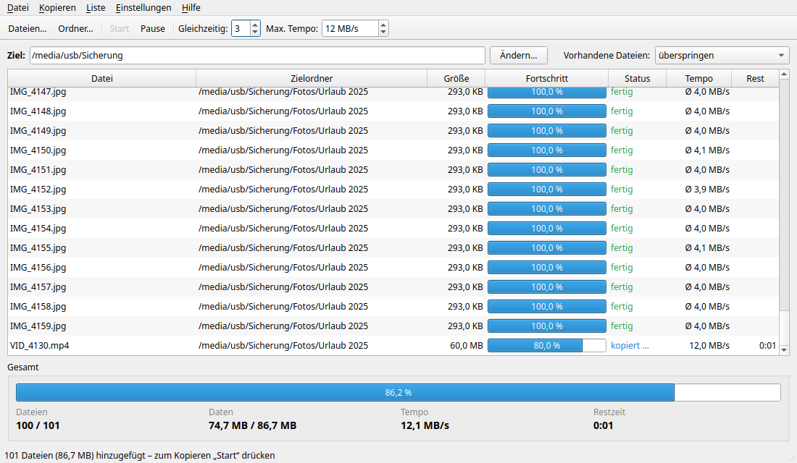

# pcopy

Paralleler, wiederaufnehmbarer Datei-Kopierer mit Qt-Oberfläche für Linux (KDE/Dolphin).
Gedacht für große Kopieraktionen – z. B. zehntausende Fotos auf eine USB-Platte –, die auch nach
Pause, Absturz oder abgezogener Platte exakt an der richtigen Stelle weitergehen.



## Funktionen

- **Hinzufügen** per „Dateien…“/„Ordner…“, Drag & Drop aus Dolphin oder Rechtsklick in Dolphin
  → „Mit pcopy kopieren“. Große Ordner werden im Hintergrund eingelesen; die Liste füllt sich
  nach und nach.
- **Mehrere Kopien gleichzeitig**, Fortschritt pro Datei und gesamt, Tempo und Restzeit;
  fertige Dateien zeigen ihr Durchschnittstempo (Ø).
- **Wiederaufnehmbar:** Pause, Beenden oder Absturz – beim nächsten Start geht es an der
  gesicherten Byte-Position weiter. Das Fenster lässt sich auch schließen, wenn die Zielplatte
  hängt.
- **Schnell bei vielen kleinen Dateien:** Dateien unter 8 MB werden gesammelt per `syncfs`
  gesichert statt einzeln. Was beim Beenden noch nicht sicher auf der Platte war, wird beim
  nächsten Start automatisch neu kopiert.
- **Kopiert erst nach „Start“** – auch beim Aufruf aus Dolphin. Ist alles fertig, hält pcopy an;
  neu hinzugefügte Dateien warten wieder auf „Start“.
- **Tempo-Begrenzung** (MB/s, gesamt), damit der Rechner nebenher flüssig bleibt.
- **Vorhandene Zieldateien:** überspringen, überschreiben oder nur durch neuere ersetzen.
- **Ziel pro Datei:** Ein neuer Zielordner gilt für danach hinzugefügte Dateien; per Rechtsklick
  → „Zielordner aktualisieren“ lassen sich wartende Dateien auf das aktuelle Ziel umstellen.
- **Übersichtliche Liste:** optional mitlaufend; Kopien, die länger als 5 s brauchen, rücken
  zwischen fertige und wartende Dateien, damit große Dateien nicht untergehen.
- **Einstellbare Schriftgröße** (Strg++ / Strg+- / Strg+0).

## Voraussetzungen

- Linux, Python 3.8+
- PyQt6 (`sudo apt install python3-pyqt6`) oder PySide6 (`pip install pyside6`)

## Installation

```bash
git clone https://github.com/PerFermat/pcopy.git
cd pcopy
./install-pcopy.sh
```

Das Skript kopiert nichts, sondern legt nur Verweise auf den Programmordner an:
Symbol auf dem Schreibtisch, Startmenü-Eintrag, Dolphin-Kontextmenü „Mit pcopy kopieren“ und
den Befehl `pcopy-gui`. Änderungen am Programm (z. B. nach `git pull`) wirken sofort.

Starten lässt sich pcopy auch direkt:

```bash
./pcopy-gui.py [DATEI|ORDNER …]
```

Läuft schon ein Fenster, werden die Pfade dorthin übergeben.

## Daten

Die Job-Liste liegt als SQLite-Datenbank `pcopy.db` **neben dem Programm**. Einstellungen
(Fenstergröße, Zielordner, Tempo-Limit, Schriftgröße …) speichert Qt unter
`~/.config/pcopy/gui.conf`.

## Aufbau

| Datei | Inhalt |
|---|---|
| `pcopy-gui.py` | Startdatei |
| `pcopy/app.py` | Programmstart, Einzelinstanz, Übergabe von Pfaden |
| `pcopy/window.py` | Hauptfenster, Start/Pause, Anzeige, Beenden |
| `pcopy/menus.py` | Menüleiste und Kontextmenü |
| `pcopy/adding.py` | Dateien hinzufügen, Drag & Drop |
| `pcopy/listops.py` | Entfernen, Leeren, erneut versuchen, Ziel umstellen |
| `pcopy/engine.py` | Kopier-Threads, Tempo-Limit, Sichern |
| `pcopy/scanner.py` | Einlesen im Hintergrund, Regeln für vorhandene Dateien |
| `pcopy/model.py` | Tabellenmodell und Fortschrittsbalken |
| `pcopy/db.py` | Datenbank |
| `pcopy/fontsize.py` | Schriftgröße |
| `pcopy/util.py`, `pcopy/qt.py` | Hilfsfunktionen, Qt-Einbindung |

## Lizenz

GNU General Public License v3.0 – siehe [LICENSE](LICENSE).
